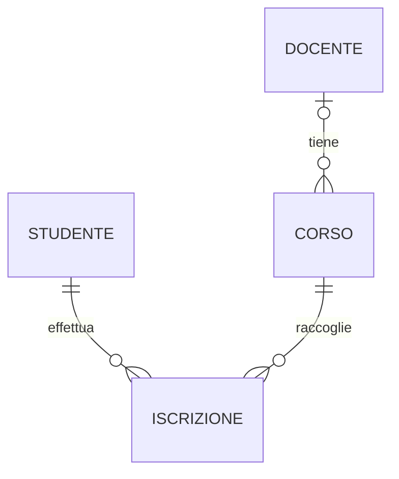

# API per la gestione di studenti e iscrizioni

REST API per gestire studenti, docenti, corsi e iscrizioni, con particolare attenzione alla separazione delle responsabilità, alla persistenza relazionale e alle regole di dominio.
Il progetto combina operazioni sulle anagrafiche, controlli di integrità e consultazione dei crediti e delle iscrizioni ai corsi.

Java · Spring Boot · PostgreSQL · Spring Data JPA · Flyway · Maven · Docker

---

## Panoramica

L'applicazione centralizza le informazioni necessarie a organizzare un'offerta formativa: permette di registrare persone e corsi, assegnare un docente e gestire quali studenti partecipano a ciascun corso.

- **Studenti:** anagrafica con email e matricola univoche.
- **Docenti:** anagrafica con email univoca e settore facoltativo.
- **Corsi:** titolo, descrizione facoltativa, crediti e docente opzionale.
- **Iscrizioni:** collegamento esplicito tra uno studente e un corso.
- **CFU:** crediti formativi universitari associati ai corsi. Il totale dello studente somma i CFU dei corsi ai quali è iscritto; non rappresenta il superamento di esami.
- **Classifica dei corsi:** conteggio degli iscritti, ordinato in modo decrescente, comprendendo anche i corsi senza iscrizioni.

Sviluppato nell'ambito del percorso ITS Academy, il progetto applica la modellazione del dominio a un servizio backend con persistenza e API REST verificabili tramite test automatici.

## Funzionalità

- Creazione, consultazione, aggiornamento ed eliminazione di studenti, docenti e corsi.
- Assegnazione facoltativa di un docente esistente a un corso.
- Iscrizione e rimozione degli studenti dai corsi, con prevenzione delle iscrizioni duplicate.
- Consultazione dei corsi di uno studente e calcolo dei CFU totali tramite JPQL.
- Classifica dei corsi per numero di iscritti tramite SQL nativo.
- Paginazione dell'elenco studenti, con un massimo di 100 elementi per pagina.
- Validazione degli input e gestione centralizzata degli errori HTTP.
- Persistenza su PostgreSQL e schema versionato con Flyway.

## Architettura

Il codice è organizzato nei seguenti package reali:

```text
src/main/java/com/example/progettofinale/
├── domain/
│   ├── model/
│   ├── repository/
│   ├── service/
│   ├── exception/
│   └── pagination/
├── data/
│   ├── entity/
│   ├── jpa/
│   ├── adapter/
│   └── mapper/
├── presentation/
│   ├── controller/
│   ├── dto/
│   └── mapper/
└── core/
    ├── config/
    └── error/
```

Il **dominio** contiene modelli, regole, servizi e interfacce repository senza dipendenze da Spring o JPA. Le interfacce in `domain.repository` costituiscono le porte verso la persistenza. Anche i tipi di paginazione sono definiti nel dominio, senza dipendere da Spring Data.

Il livello **`data`** implementa queste porte attraverso gli adapter. Al suo interno risiedono le entity JPA, i repository Spring Data, le query e i mapper tra entity e modelli di dominio.

Il livello **`presentation`** espone le API attraverso controller REST. I DTO definiscono richieste e risposte, applicano la validazione degli input e vengono convertiti da mapper dedicati. La risposta con studente e corsi è composta tramite una `Map` che riutilizza i DTO delle due risorse.

Il package **`core`** registra i servizi come bean tramite `DomainServiceConfig` e traduce le eccezioni in risposte HTTP attraverso `GlobalExceptionHandler`.

La logica applicativa risiede in `domain.service`: non esiste un package applicativo separato. Questa organizzazione mantiene distinti i casi d'uso, la persistenza e la rappresentazione REST, permettendo di verificare le regole di dominio senza avviare Spring.

## Modello di dominio

La relazione molti-a-molti tra `Studente` e `Corso` è rappresentata dall'entità esplicita **`Iscrizione`**, con un proprio identificativo e riferimenti alle due risorse. Ogni iscrizione collega esattamente uno studente a un corso; la stessa coppia non può essere registrata due volte.

Un docente può essere associato a più corsi. Ogni corso può avere un solo docente oppure nessuno.



`CorsoClassificaIscritti` rappresenta un risultato aggregato, separato dal modello `Corso`: il numero di iscritti è calcolato dalle iscrizioni e non memorizzato come attributo del corso.

## API

URL di base locale: `http://localhost:8080/api`.

### Studenti

| Metodo | Percorso | Descrizione |
|---|---|---|
| GET | `/api/studenti?page=0&size=10` | Elenco paginato degli studenti. |
| GET | `/api/studenti/{id}` | Dettaglio di uno studente. |
| POST | `/api/studenti` | Creazione di uno studente. |
| PUT | `/api/studenti/{id}` | Aggiornamento completo di uno studente esistente. |
| DELETE | `/api/studenti/{id}` | Eliminazione di uno studente. |

La numerazione delle pagine parte da zero. La risposta include `content`, `page`, `size`, `totalElements` e `totalPages`.

### Docenti

| Metodo | Percorso | Descrizione |
|---|---|---|
| GET | `/api/docenti` | Elenco dei docenti. |
| GET | `/api/docenti/{id}` | Dettaglio di un docente. |
| POST | `/api/docenti` | Creazione di un docente. |
| PUT | `/api/docenti/{id}` | Aggiornamento completo di un docente esistente. |
| DELETE | `/api/docenti/{id}` | Eliminazione di un docente. |

### Corsi

| Metodo | Percorso | Descrizione |
|---|---|---|
| GET | `/api/corsi` | Elenco dei corsi. |
| GET | `/api/corsi/{id}` | Dettaglio di un corso. |
| POST | `/api/corsi` | Creazione di un corso, anche senza docente. |
| PUT | `/api/corsi/{id}` | Aggiornamento completo di un corso esistente. |
| DELETE | `/api/corsi/{id}` | Eliminazione di un corso. |
| GET | `/api/corsi/classifica-iscritti` | Classifica per numero di iscritti. |

### Iscrizioni e crediti

Le iscrizioni sono esposte da `StudenteController` come risorse associate allo studente.

| Metodo | Percorso | Descrizione |
|---|---|---|
| POST | `/api/studenti/{id}/corsi/{corsoId}` | Iscrizione a un corso; risposta `200` senza corpo. |
| DELETE | `/api/studenti/{id}/corsi/{corsoId}` | Rimozione di un'iscrizione. |
| GET | `/api/studenti/{id}/corsi` | Dati dello studente e lista dei corsi seguiti. |
| GET | `/api/studenti/{id}/cfu-totali` | Identificativo dello studente e somma dei CFU. |

Le creazioni di studenti, docenti e corsi restituiscono `201` con il DTO della risorsa e l'header `Location`. Le eliminazioni restituiscono `204` senza corpo. Gli errori principali sono `400` per input non validi, `404` per risorse assenti e `409` per duplicati o violazioni di integrità. Le risposte di errore contengono `message` ed eventualmente `errors` con i dettagli dei campi.

## Esempio di utilizzo

Le seguenti richieste possono essere inviate con un client HTTP come Postman. I dati sono di esempio.

### 1. Creare uno studente

```http
POST http://localhost:8080/api/studenti
Content-Type: application/json

{
  "nome": "Anna",
  "cognome": "Rossi",
  "email": "anna.rossi@example.com",
  "matricola": "STU-001"
}
```

La risposta `201` contiene `id`, `nome`, `cognome`, `email` e `matricola`. Conservare l'identificativo restituito.

### 2. Creare un corso senza docente

```http
POST http://localhost:8080/api/corsi
Content-Type: application/json

{
  "titolo": "Basi di dati",
  "descrizione": "Modellazione relazionale e SQL",
  "cfu": 6,
  "docenteId": null
}
```

### 3. Iscrivere lo studente e consultare i CFU

Supponendo che entrambe le creazioni restituiscano `id: 1`, inviare una richiesta senza corpo:

```http
POST http://localhost:8080/api/studenti/1/corsi/1
```

L'iscrizione restituisce `200` senza corpo; ripetere la stessa richiesta produce `409`. Sostituire gli identificativi con quelli effettivamente ricevuti.

```http
GET http://localhost:8080/api/studenti/1/cfu-totali
```

Se questa è l'unica iscrizione dello studente, la risposta prevista è:

```json
{
  "studenteId": 1,
  "cfuTotali": 6
}
```

## Database

PostgreSQL è il database principale; Docker Compose utilizza l'immagine `postgres:16`. Spring Data JPA gestisce l'accesso ai dati, mentre Flyway applica la migrazione [V1__init_schema.sql](src/main/resources/db/migration/V1__init_schema.sql). Hibernate usa `ddl-auto: validate` per verificare la corrispondenza tra schema ed entity.

I vincoli principali sono:

- chiavi primarie generate per studenti, docenti, corsi e iscrizioni;
- email univoca all'interno delle rispettive tabelle di studenti e docenti; matricola univoca per gli studenti;
- unicità composta su `iscrizione(studente_id, corso_id)`;
- chiavi esterne obbligatorie verso studente e corso, con `ON DELETE CASCADE` sulle iscrizioni;
- docente facoltativo nel corso, con `ON DELETE SET NULL` alla cancellazione del docente;
- campi obbligatori e limiti di lunghezza definiti nello schema.

La positività dei CFU è verificata nei DTO e nel servizio di dominio; la migrazione attuale non definisce un vincolo SQL `CHECK` su questo valore.

Nei test viene utilizzato **H2 in memoria**, in modalità di compatibilità PostgreSQL. In quella configurazione Flyway è disabilitato e Hibernate crea ed elimina lo schema con `create-drop`.

## Avvio locale

### Prerequisiti

- JDK **26**, coerente con `java.version` nel `pom.xml`.
- Maven **3.9.16**, versione indicata anche dalla configurazione del wrapper incluso.
- Docker con Docker Compose per avviare PostgreSQL.
- Git per clonare il repository e accesso alla rete per scaricare le dipendenze mancanti.

### 1. Ottenere il progetto

Sostituire `<URL_DEL_REPOSITORY>` con l'URL Git del progetto. Il segnaposto è intenzionale: nella copia esaminata non è disponibile un remoto Git verificabile.

```bash
git clone <URL_DEL_REPOSITORY> ProgettoSpringBoot_ArlonCava
cd ProgettoSpringBoot_ArlonCava/ProgettoFinale
```

Tutti i comandi successivi vanno eseguiti dalla directory `ProgettoFinale`, che contiene `pom.xml`.

### 2. Configurare l'ambiente

Impostare `JAVA_HOME` sul JDK 26 e verificare il JDK usato da Maven:

```bash
mvn -version
```

La configurazione applicativa è in [application.yaml](src/main/resources/application.yaml); quella del database è in [database/docker-compose.yml](database/docker-compose.yml).

Il collegamento predefinito usa `jdbc:postgresql://localhost:5443/postgres`. Prima del primo avvio, scegliere credenziali locali e allineare `POSTGRES_USER` e `POSTGRES_PASSWORD` nel servizio Compose con `spring.datasource.username` e `spring.datasource.password` dell'applicazione. Se si modifica `POSTGRES_DB`, aggiornare anche il nome del database nell'URL JDBC.

Per l'applicazione è possibile sovrascrivere la configurazione attraverso le variabili d'ambiente `SPRING_DATASOURCE_URL`, `SPRING_DATASOURCE_USERNAME` e `SPRING_DATASOURCE_PASSWORD`. Queste variabili non modificano automaticamente il file Compose, che attualmente contiene valori espliciti. Non è previsto un file `.env.example`.

Le impostazioni `POSTGRES_*` inizializzano il database soltanto quando il volume è vuoto: modificarle non aggiorna le credenziali di un database già inizializzato.

### 3. Avviare PostgreSQL

```bash
docker compose -f database/docker-compose.yml up -d
```

Compose avvia **soltanto PostgreSQL**, con porta `5443` sull'host e `5432` nel container. I dati persistono nel volume `postgres_data_project`. Attendere che il database sia pronto; è possibile controllarne i log con:

```bash
docker compose -f database/docker-compose.yml logs postgres
```

### 4. Avviare l'applicazione

```bash
mvn spring-boot:run
```

In PowerShell si può usare `mvn.cmd spring-boot:run`. Flyway applica le migrazioni e Hibernate valida lo schema prima che l'applicazione sia disponibile.

### 5. Accedere alle API

In assenza di personalizzazioni, Spring Boot utilizza la porta **8080**. Una prima richiesta è:

```http
GET http://localhost:8080/api/studenti?page=0&size=10
```

## Test

La suite comprende:

- `CorsoServiceTest`: creazione di corsi con docente opzionale e verifica dell'esistenza del docente indicato.
- `IscrizioneServiceTest`: creazione delle iscrizioni, risorse mancanti, duplicati e rimozione di iscrizioni inesistenti, con repository sostitutivi in memoria.
- `DocenteCorsoAndStudentiPaginationIntegrationTest`: integrazione con MockMvc per docenti, associazione ai corsi e paginazione degli studenti.
- `RestApiCrudEdIscrizioneIntegrationTest`: operazioni REST, validazione, errori, iscrizioni, CFU e classifica dei corsi.
- `ProgettoFinaleApplicationTests`: caricamento del contesto Spring.

I test REST usano MockMvc per esercitare il livello MVC senza un server HTTP su una porta reale. La configurazione H2 dedicata permette di eseguire la suite senza avviare PostgreSQL.

Con JDK 26 configurato, eseguire:

```bash
mvn test
```

In PowerShell il comando equivalente è `mvn.cmd test`. Sono inclusi anche gli script `mvnw` e `mvnw.cmd`; nell'ambiente della verifica `mvnw.cmd test` si è interrotto prima dell'avvio di Maven con un errore del wrapper, quindi qui viene documentato Maven installato localmente.

Verifica del 5 ottobre 2026 con OpenJDK 26.0.1 e Maven 3.9.16: **17 test eseguiti, nessun fallimento, nessun errore e nessun test saltato**, con esito Maven `BUILD SUCCESS`. Il comando utilizzato è `mvn.cmd "-Dmaven.repo.local=<PERCORSO_CACHE_MAVEN>" test`, impostando `JAVA_HOME` sul JDK 26 e sostituendo il segnaposto con la cache locale dell'utente. L'opzione sul repository locale è stata necessaria per l'ambiente di verifica. Questa esecuzione valida la suite su H2; non costituisce una verifica dell'avvio su PostgreSQL.

## Aspetti tecnici di rilievo

- Dominio indipendente da Spring e JPA, collegato alla persistenza tramite porte e adapter.
- Relazione molti-a-molti modellata con un'entità di dominio esplicita.
- Migrazione Flyway con vincoli di unicità e regole di cancellazione.
- DTO validati e traduzione centralizzata delle eccezioni in risposte HTTP.
- Query JPQL e SQL nativo per aggregazioni, affiancate da test REST con MockMvc.

## Decisioni progettuali

### Iscrizione come entità esplicita

`Iscrizione` rende visibile nel dominio il legame studente-corso e permette di concentrare nel servizio dedicato i controlli su esistenza e duplicati. Il vincolo composto nel database protegge la stessa regola a livello di persistenza.

### Separazione del dominio

Modelli di dominio, entity JPA e DTO hanno responsabilità distinte. I mapper richiedono codice aggiuntivo, ma evitano che annotazioni di persistenza e vincoli HTTP entrino nei modelli centrali. La configurazione dei bean resta in `core.config`.

### Schema versionato

Flyway rende esplicita la definizione dello schema, incluse le regole sulle chiavi esterne. La modalità `validate` di Hibernate verifica l'allineamento con le entity senza generare automaticamente le tabelle nell'ambiente principale.

## Limiti attuali

- Autenticazione e autorizzazione non sono implementate.
- Docker Compose gestisce il database; l'applicazione viene avviata separatamente tramite Maven.
- I test con H2 non verificano le migrazioni Flyway né garantiscono il comportamento su PostgreSQL reale.
- I casi d'uso che comprendono più operazioni repository non hanno un confine transazionale applicativo esplicito: le transazioni dei repository e i vincoli SQL non rendono atomica l'intera sequenza di controlli e scritture.
- La configurazione del database contiene valori locali espliciti; la gestione delle credenziali resta da esternalizzare in modo uniforme tra applicazione e Compose.

## Possibili miglioramenti

- Autenticazione e autorizzazione con Spring Security e JWT.
- Documentazione del contratto API con OpenAPI e Swagger UI.
- Esecuzione automatica dei test con GitHub Actions.
- Test d'integrazione su PostgreSQL, incluse le migrazioni Flyway, tramite Testcontainers.
- Containerizzazione dell'applicazione, configurazione esterna delle credenziali e definizione di transazioni per gli interi casi d'uso.

## Competenze consolidate

Attraverso questo progetto ho approfondito:

- la progettazione di API REST con Spring Boot, DTO e semantica degli status HTTP;
- la modellazione di relazioni molti-a-molti e vincoli di integrità;
- la separazione delle responsabilità tramite interfacce, adapter e mapper;
- la persistenza con JPA e PostgreSQL, le query aggregate e le migrazioni dello schema;
- la verifica delle regole di dominio e dei flussi REST, inclusi input non validi e gestione degli errori.

## Contesto

Progetto sviluppato come lavoro finale durante il percorso Java Spring Boot presso ITS Academy, con particolare attenzione all'architettura backend, alle API REST e alla persistenza relazionale.

## Autore

Arlon Cava
